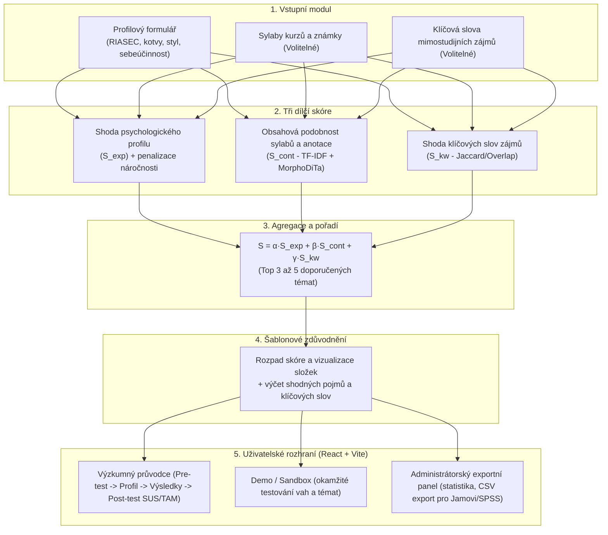
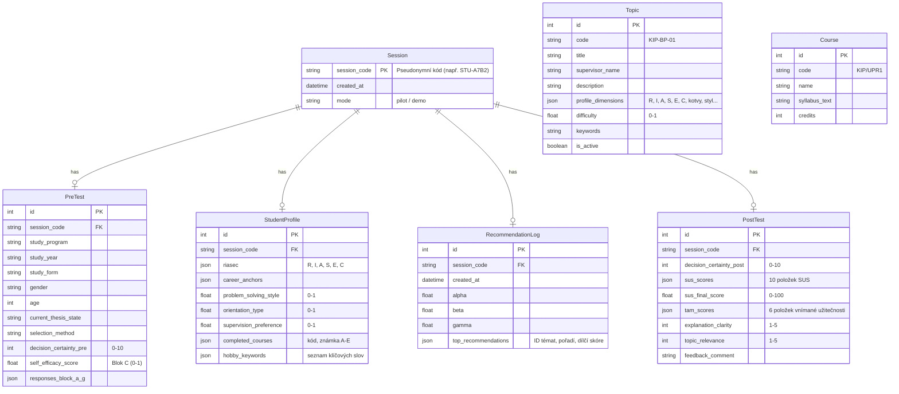

# Systémová architektura: Doporučovací systém pro výběr závěrečné práce (DSR Artefakt)

Tento dokument definuje systémovou architekturu, matematický model, datové schéma a API kontrakty pro softwarový prototyp bakalářské práce **Davida Faula** (*Katedra informatiky a počítačů, Přírodovědecká fakulta, Ostravská univerzita*, 2027).

---

## 1. Konceptuální fázový diagram (DSR Artefakt)



---

## 2. Matematický model doporučovacího systému

### 2.1 Celkové vážené skóre ($S_i$)
Pro libovolné téma $i$ z katalogu vypsaných témat je celkové skóre definováno vztahem:
$$S_i = \alpha \cdot S_{\text{exp},i} + \beta \cdot S_{\text{cont},i} + \gamma \cdot S_{\text{kw},i}$$

Výchozí nastavení vah pro studenta, který zadá všechny složky:
$$\alpha = 0{,}5, \quad \beta = 0{,}3, \quad \gamma = 0{,}2 \quad (\alpha + \beta + \gamma = 1)$$

#### Pravidlo dynamického přepočtu vah:
- Pokud student **nevyplní sylaby/známky** i **klíčová slova** (pouze povinné jádro): $\alpha = 1{,}0, \beta = 0, \gamma = 0$.
- Pokud student vyplní povinné jádro a pouze sylaby: $\alpha = \frac{0{,}5}{0{,}8} = 0{,}625, \beta = \frac{0{,}3}{0{,}8} = 0{,}375, \gamma = 0$.
- Pokud student vyplní povinné jádro a pouze klíčová slova: $\alpha = \frac{0{,}5}{0{,}7} \approx 0{,}714, \beta = 0, \gamma = \frac{0{,}2}{0{,}7} \approx 0{,}286$.

### 2.2 Expertní profilové skóre ($S_{\text{exp},i}$)
$$S_{\text{exp},i} = \left( \sum_{p \in P} w_p \cdot \text{match}(p, i) \right) \cdot \left[ 1 - \lambda \cdot (1 - I_{\text{eff}}) \cdot d_i \right]$$
kde:
- $P$ je množina profilových dimenzí: RIASEC ($R, I, A, S, E, C$), Scheinovy kariérní kotvy, styl řešení problémů (adaptivní vs. inovativní), orientace (datově-technická vs. sociálně-pedagogická), preference supervize.
- $\text{match}(p, i) = 1 - |u_p - t_{p,i}|$, kde $u_p \in [0, 1]$ je normalizovaná hodnota studenta a $t_{p,i} \in [0, 1]$ je anotace tématu.
- $w_p \ge 0, \sum_p w_p = 1$.
- $I_{\text{eff}} \in [0, 1]$ je index výzkumné sebeúčinnosti studenta (z Bloku C).
- $d_i \in [0, 1]$ je úroveň metodologické náročnosti tématu.
- $\lambda \in [0, 1]$ je síla penalizace náročnosti (výchozí hodnota $\lambda = 0{,}25$).

### 2.3 Obsahová podobnost sylabů a anotace ($S_{\text{cont},i}$)
$$S_{\text{cont},i} = \text{CosineSimilarity}(\vec{u}_{\text{courses}}, \vec{v}_{\text{topic},i}) = \frac{\vec{u}_{\text{courses}} \cdot \vec{v}_{\text{topic},i}}{\|\vec{u}_{\text{courses}}\| \|\vec{v}_{\text{topic},i}\|}$$
- Texty sylabů předmětů a popisy témat jsou lemmatizovány českým nástrojem **MorphoDiTa** (s fallbackem) a očištěny o stop-slova.
- Vektor studenta $\vec{u}_{\text{courses}}$ je váženým průměrem TF-IDF vektorů absolvovaných předmětů s vahami $g \in [0{,}5; 1{,}0]$ podle známky ($A=1{,}0, B=0{,}9, C=0{,}8, D=0{,}7, E=0{,}6, F/neabsolvováno=0$).

### 2.4 Shoda klíčových slov zájmů ($S_{\text{kw},i}$)
$$S_{\text{kw},i} = \frac{|K_u \cap K_i|}{|K_u|}$$
kde $K_u$ je lemmatizovaná množina mimostudijních zájmů studenta a $K_i$ je množina lemmat popisu a klíčových slov tématu. Při $K_u = \emptyset$ je $S_{\text{kw},i} = 0$.

### 2.5 Řešení shod (Tie-breaking)
Při rovnosti skóre rozhoduje:
1. Vyšší dílčí skóre $S_{\text{exp}}$
2. Nižší náročnost tématu $d_i$
3. Abecední pořadí názvů témat

---

## 3. Datový model (SQLite + SQLAlchemy)



---

## 4. REST API Endpointy

| Metoda | Endpoint | Popis |
|---|---|---|
| `POST` | `/api/session/init` | Inicializace nového sezení, vygenerování pseudonymního kódu |
| `POST` | `/api/pre-test` | Uložení demografie a pre-testu jistoty a sebeúčinnosti |
| `POST` | `/api/profile` | Uložení studentského profilu (RIASEC, sylaby, klíčová slova) |
| `POST` | `/api/recommendations` | Výpočet skóre, vrácení Top 3–5 témat s rozpadem a zdůvodněním |
| `POST` | `/api/post-test` | Uložení post-testu (rozhodovací jistota, SUS, TAM, hodnocení) |
| `GET`  | `/api/topics` | Seznam dostupných témat pro demo mód |
| `GET`  | `/api/courses` | Seznam předmětů katedry pro výběr sylabů |
| `GET`  | `/api/admin/stats` | Přehled pilotního testování: N, průměrné SUS, posun jistoty $d_z$ |
| `GET`  | `/api/admin/export.csv` | Export anonymních dat do CSV pro Jamovi, SPSS, R a Python |
| `POST` | `/api/admin/import-topics` | Import témat z CSV/JSON/TSV exportu |

---

## 5. Struktura repozitáře

```
BC_Faul_Web/
├── backend/
│   ├── app/
│   │   ├── api/             # FastAPI routery (session, pretest, profile, recommend, posttest, admin)
│   │   ├── core/            # Konfigurace, nastavení, bezpečnost
│   │   ├── models/          # SQLAlchemy modely
│   │   ├── schemas/         # Pydantic schémata a DTO
│   │   ├── services/        # Doporučovací jádro (scorer, lemmatizer, importer)
│   │   └── data/            # SQLite databáze a seed data
│   ├── requirements.txt
│   └── run.py               # Spouštěč backendu
├── frontend/
│   ├── src/
│   │   ├── components/      # UI komponenty (průvodce, formuláře, karty témat, grafy skóre)
│   │   ├── pages/           # Stránky (Wizard, DemoSandbox, AdminPanel)
│   │   ├── services/        # API klient (Axios/fetch)
│   │   ├── types/           # TypeScript rozhraní
│   │   └── App.tsx
│   ├── package.json
│   ├── vite.config.ts
│   └── tailwind.config.js
├── data/
│   ├── import/              # Složka pro dodatečné nahrání exportů z KIP
│   └── seeds/               # Výchozí reálná témata a sylaby KIP PřF OU
├── SYSTEM_ARCHITECTURE.md
└── README.md
```
